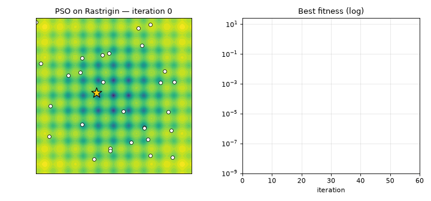
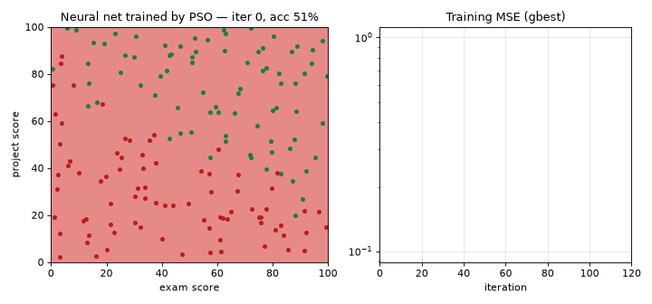
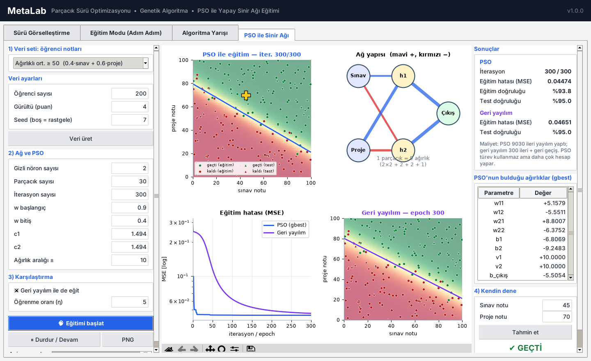
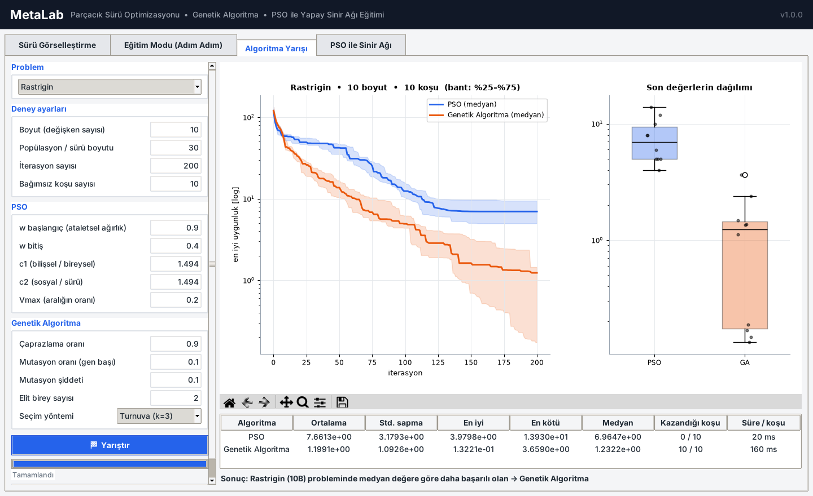
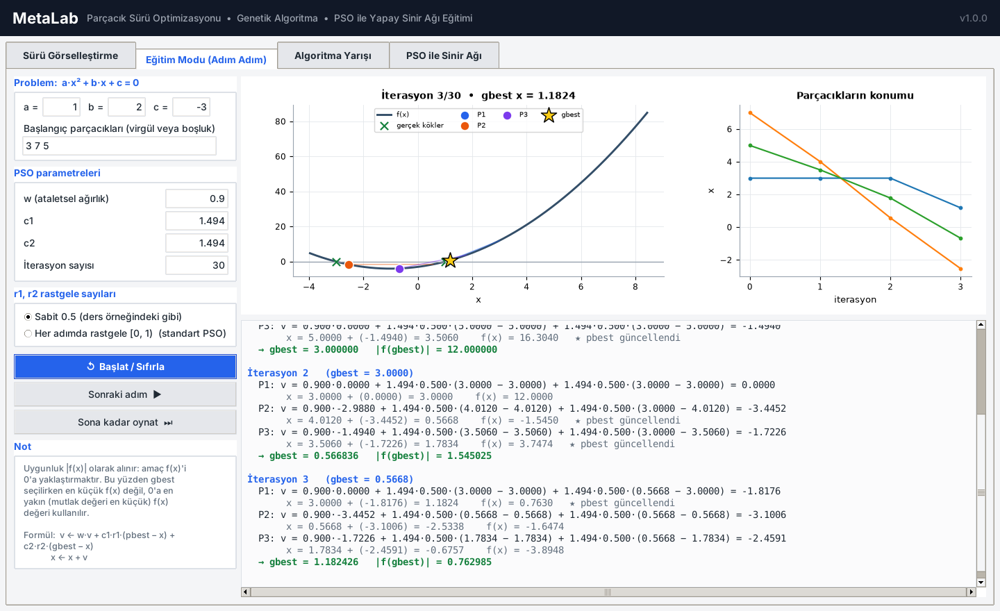

# MetaLab — Metaheuristic Optimization Lab

**Interactive desktop lab for Particle Swarm Optimization, Genetic Algorithms, and neural networks trained by PSO instead of backpropagation.**

  

| PSO swarm on Rastrigin | Neural network trained by PSO |
|---|---|
|  |  |

Built as a course project for **Computational Intelligence (İşlemsel Zeka)**. Every algorithm is implemented from scratch with NumPy, without any optimization library.

## Features

| Tab | What it does |
|---|---|
| **Swarm Visualization** | Watch PSO particles (with velocity arrows) or a GA population move across the landscape of 6 benchmark functions, or a function you type in (`sin(x)*cos(y) + 0.1*(x**2+y**2)`). Live convergence curve, pause / single step, PNG and CSV export. |
| **Teaching Mode** | Solves the lecture example (find the root of `a·x² + b·x + c`) and prints every term of the velocity update with real numbers, iteration by iteration. |
| **Algorithm Race** | PSO vs Genetic Algorithm over N independent runs: median convergence with an inter-quartile band, box plot, and a mean / std / best / worst / win-count table. |
| **PSO-trained Neural Net** | A 2-H-1 network learns *exam + project score → pass/fail*. Every particle is a full weight vector (9 numbers for H = 2), and its fitness is the training MSE. The decision boundary, network diagram, and loss curve update live. Backpropagation runs side by side for comparison, and a "try it" box predicts for any pair of scores. |

### Screenshots




## How PSO trains the network

```
particle = [ w11 w12 w21 w22 | b1 b2 | v1 v2 | b_out ]   (4H + 1 numbers)
fitness(particle) = mean( (network(X; particle) − y)² )
```

PSO never computes a gradient. It moves 30 candidate networks through the weight space using
`v ← w·v + c1·r1·(pbest − x) + c2·r2·(gbest − x)`. Inputs are scaled from 0–100 to 0–1. Without this scaling, raw scores push the sigmoid neurons into saturation and the network cannot learn.

**Trade-off shown in the app:** after 300 iterations, PSO typically reaches a lower training error than 300 epochs of backprop. It pays for this with ~30× more forward passes (one per particle per iteration).

## Installation

```bash
git clone https://github.com/<your-username>/metaheuristic-lab.git
cd metaheuristic-lab
pip install -r requirements.txt
python main.py
```

Tkinter ships with Python on Windows and macOS. On Ubuntu/Debian, install it with `sudo apt install python3-tk`.

```bash
pytest -q                 # 25 unit tests (gradient check, velocity formula, convergence...)
python tools/make_gifs.py # regenerate the README animations
```

## Project structure

```
metalab/
├── algorithms/
│   ├── pso.py         # step-able PSO: linearly decreasing inertia, velocity clamp, seed
│   └── ga.py          # real-coded GA: tournament/roulette, BLX-α crossover, Gaussian mutation, elitism
├── benchmarks.py      # Sphere, Rastrigin, Ackley, Rosenbrock, Griewank, Himmelblau
├── expression.py      # safe (AST-whitelisted) parser for user-typed functions
├── neural.py          # MLP with flat weight vector, dataset generator, backprop baseline
└── gui/               # Tkinter + embedded Matplotlib, one file per tab
tests/test_core.py
tools/                 # GIF and screenshot generators
```

## Design notes
- **Step-able optimizers.** `PSO.step()` and `GeneticAlgorithm.step()` advance one iteration and return the intermediate values. The GUI animates with `after()` and never blocks. The teaching tab prints the returned velocity terms.
- **Vectorized.** Objectives take an `(n_points, dim)` array. The network evaluates all 30 particles in one `einsum` call.
- **Responsive UI.** The 20-run statistical race runs in a background thread and reports progress through a queue.

## References
- Kennedy, J. & Eberhart, R. (1995). *Particle Swarm Optimization*. Proc. IEEE ICNN.
- Shi, Y. & Eberhart, R. (1998). *A Modified Particle Swarm Optimizer*. IEEE ICEC.
- Goldberg, D. E. (1989). *Genetic Algorithms in Search, Optimization and Machine Learning*.
- Lecture notes, Computational Intelligence course.

---

## Türkçe Özet

**MetaLab**, İşlemsel Zeka dersi için hazırlanmış bir optimizasyon laboratuvarıdır. Dört sekmeden oluşur:

1. **Sürü Görselleştirme:** PSO veya GA'nın test fonksiyonları ya da kullanıcının yazdığı fonksiyon üzerinde canlı animasyonu.
2. **Eğitim Modu:** Ders örneğindeki (ax² + bx + c = 0) PSO hesabının, hız formülündeki her terimle adım adım gösterimi.
3. **Algoritma Yarışı:** PSO ile Genetik Algoritmanın N bağımsız koşuda istatistiksel karşılaştırması.
4. **PSO ile Sinir Ağı:** Yapay sinir ağının ağırlıkları geri yayılım yerine PSO ile bulunur. Her parçacık ağın tüm ağırlıklarını taşır, uygunluk değeri ise eğitim hatasıdır (MSE). Bu, derste vurgulanan **hibrit yaklaşımın** bir örneğidir.

Tüm parametreler arayüzden girilir ve sonuçlar grafik ve tablolarla gösterilir. Çalıştırmak için: `pip install -r requirements.txt` ve ardından `python main.py`.

## License
MIT. See [LICENSE](LICENSE).
